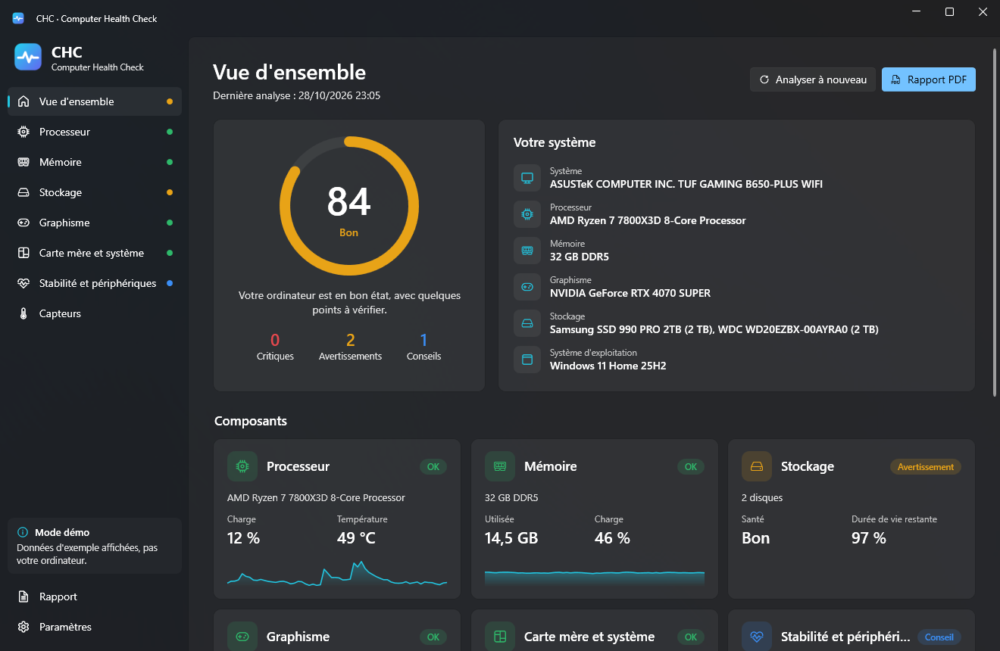

<p align="center">
  
</p>

<h1 align="center">CHC – Computer Health Check</h1>

<p align="center">
  Une application Windows gratuite qui vérifie la santé de votre PC (processeur, mémoire, disques, carte graphique, batterie, carte mère et stabilité du système) et explique les résultats, d'un résumé en langage simple jusqu'aux données techniques brutes.
</p>

<p align="center">
  <a href="README.md">English</a> ·
  <a href="README.tr.md">Türkçe</a> ·
  <a href="README.de.md">Deutsch</a> ·
  <a href="README.es.md">Español</a> ·
  <b>Français</b> ·
  <a href="README.pt-BR.md">Português (Brasil)</a> ·
  <a href="README.ru.md">Русский</a> ·
  <a href="README.zh-CN.md">简体中文</a>
</p>

<p align="center">
  
</p>

## Fonctionnalités

- **Score de santé (0–100)** pour l'ordinateur entier et pour chaque composant, avec des états clairs : *OK / Conseil / Avertissement / Critique*.
- **Problèmes et recommandations.** Chaque constat explique ce qui ne va pas, pourquoi c'est important et quoi faire.
- **Du simple au technique.** Chaque page de composant commence par un court résumé, puis les valeurs en direct, les caractéristiques techniques, des tableaux (modules de mémoire, attributs SMART, journal des événements) et tous les capteurs bruts.
- **Processeur :** charge, température, fréquences, puissance, cœurs et threads, cache, virtualisation.
- **Mémoire :** utilisation, mémoire engagée, modules par emplacement (type, vitesse, référence), détection du simple canal et de XMP/EXPO.
- **Stockage :** état de santé Windows et SMART complet (le même moteur que CrystalDiskInfo, via DiskInfoToolkit) : durée de vie restante, température, heures de fonctionnement, total écrit, secteurs réalloués, en attente et non corrigibles, avertissements critiques NVMe et espace libre par lecteur.
- **Graphisme :** température, point chaud, température de la mémoire, charge, puissance, VRAM, version et âge du pilote.
- **Batterie** (portables) : niveau d'usure, capacité nominale et de pleine charge, cycles.
- **Carte mère et système :** version et âge du BIOS/UEFI, démarrage sécurisé, TPM, version de Windows et temps d'activité.
- **Stabilité :** arrêts inattendus, écrans bleus, erreurs matérielles WHEA et erreurs disque des 30 derniers jours, ainsi que les problèmes du Gestionnaire de périphériques.
- **Capteurs en direct** pour tout ce que LibreHardwareMonitor peut lire, avec un filtre.
- **Rapport PDF** en un clic avec une mise en page prête à l'emploi. Export JSON et résumé texte à coller sur les forums également disponibles. Les numéros de série restent masqués sauf si vous les activez.
- **8 langues :** English, Türkçe, Deutsch, Español, Français, Português (Brasil), Русский, 简体中文. D'autres peuvent être ajoutées sans recompiler.
- Thème clair et sombre (suit Windows), design Fluent de Windows 11.

## Téléchargement et lancement

1. Téléchargez `CHC.exe` depuis la page [Releases](../../releases).
2. Lancez-le. CHC nécessite le [.NET 10 Desktop Runtime](https://dotnet.microsoft.com/download/dotnet/10.0) (Windows propose de l'installer au premier lancement s'il manque).

Sans droits d'administrateur, CHC démarre en **mode limité**. Cliquez sur **Exécuter en administrateur** dans la barre latérale pour accéder aux données SMART et à davantage de capteurs.

La température du processeur et les capteurs de la carte mère (ventilateurs, tensions) nécessitent aussi le pilote gratuit et signé [PawnIO](https://pawnio.eu), utilisé par les outils de surveillance modernes. CHC fonctionne sans lui et vous prévient lorsqu'il manque.

> CHC se contente de lire des informations. Il ne modifie aucun réglage, n'overclocke rien et n'écrit jamais sur vos disques.

## Compiler depuis les sources

Prérequis : Windows 10/11 x64 et le [SDK .NET 10](https://dotnet.microsoft.com/download/dotnet/10.0).

```bash
git clone https://github.com/aliinal0/CHC.git
cd CHC
dotnet run --project src/CHC.App
```

Créer un seul fichier `CHC.exe` :

```bash
dotnet publish src/CHC.App -c Release -r win-x64 --self-contained false -p:PublishSingleFile=true -o publish
```

Vous voulez modifier un seuil ou ajouter une vérification ? Toutes les règles se trouvent dans `src/CHC.Core/Health/HealthAnalyzer.cs`, et les textes, sous les mêmes clés, dans les fichiers de langue.

## Traductions

Tous les textes se trouvent dans `src/CHC.Core/Localization/Languages/<code>.json`. Pour ajouter une langue :

1. Copiez `en.json` en `<code>.json` (par exemple `it.json`).
2. Traduisez les valeurs sans modifier les clés ni les marqueurs comme `{0}`.
3. Ouvrez une pull request ou placez le fichier dans le dossier `Languages` à côté de `CHC.exe`. Il apparaît dans **Paramètres → Langue** après un redémarrage.

Voir [CONTRIBUTING.md](CONTRIBUTING.md) pour plus de détails.

## Licence

CHC est publié sous la **[PolyForm Noncommercial License 1.0.0](LICENSE)**.

- ✅ Vous pouvez utiliser, étudier, modifier et partager CHC gratuitement à des fins personnelles et non commerciales.
- ❌ Vous ne pouvez pas vendre CHC, le distribuer contre de l'argent ni l'utiliser à des fins commerciales.

Les composants tiers conservent leurs propres licences : [THIRD-PARTY-NOTICES.md](THIRD-PARTY-NOTICES.md).

## Avertissement

Le score de santé repose sur les données fournies par votre matériel et sur des règles empiriques courantes. C'est un indicateur utile, pas une garantie. Sauvegardez toujours vos données importantes.
