<p align="center">
  
</p>

<h1 align="center">CHC – Computer Health Check</h1>

<p align="center">
  <b>Find out what is really going on inside your PC.</b><br>
  A free Windows app that checks every major part of your computer, finds out why it freezes or crashes,<br>
  remembers when a problem began, tests your games and your connection, and explains everything in plain language.
</p>

<p align="center">
  <a href="../../releases/latest"></a>
  
  
  <a href="LICENSE"></a>
  <a href="#how-chc-is-made"></a>
</p>

<p align="center">
  <a href="#what-chc-checks">What it checks</a> ·
  <a href="#how-it-works">How it works</a> ·
  <a href="#a-quick-tour">Tour</a> ·
  <a href="#is-it-safe">Is it safe?</a> ·
  <a href="#download-and-install">Download</a> ·
  <a href="#faq">FAQ</a> ·
  <a href="#how-chc-is-made">How it's made</a>
</p>

<p align="center">
  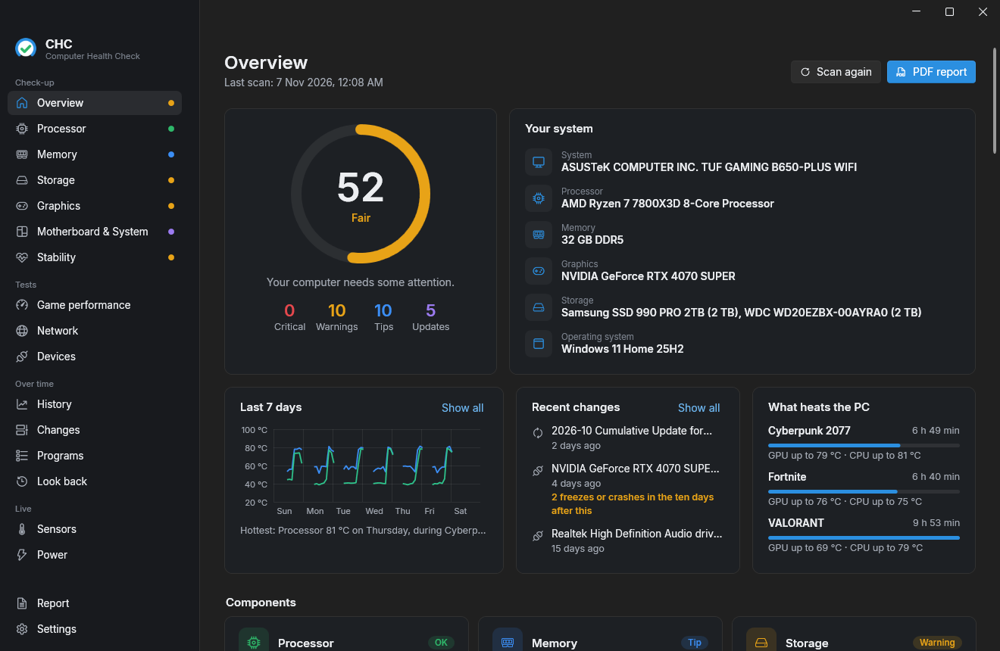
</p>
<p align="center"><sub>All screenshots on this page come from CHC's built-in <b>demo mode</b>, which shows a made-up sample PC with made-up problems, not anyone's real computer.</sub></p>

---

## Why CHC?

Hardware tools usually show you hundreds of numbers (temperatures, SMART attributes, event IDs, voltages) and leave you to work out whether any of them is a problem. CHC reads the same data, checks it against known rules and tells you, in everyday language:

- **what is wrong** (or that nothing is),
- **why it matters**, and
- **what you can do about it**.

It is made for ordinary users who want a straight answer, and it still shows every technical detail for those who want to dig deeper.

| What you get | What it means |
|---|---|
| 🩺 **One clear score** | A 0–100 health score for the whole PC and for each part, with *OK / Tip / Update / Warning / Critical* labels. |
| 💡 **Explanations, not just numbers** | Every finding says what it means and what to do next. Many open up into step-by-step help. |
| 🧊 **Answers for freezes and crashes** | The likely cause of each one, from the clues Windows logged just before it. |
| ⬇️ **What to update** | Newer drivers, Windows updates and programs, looked up once a day, each with a link to where to get it. They have their own list, with drivers and Windows first. |
| 🕰️ **A memory for your PC** | While it runs, CHC notes temperatures, load, power and what changed, so it can show when a problem began. |
| 🔙 **A look at the time before CHC** | If you ask, it reads Windows' own notes on what ran over about the last two months. It always marks them *Non-CHC record*. |
| 🎮 **Game and network tests** | How each game runs, what holds it back, and where lag comes from, with advice that fits your PC and your game's settings. |
| 🔌 **Devices** | What is connected, and a warning only when a device has a real driver or connection problem. |
| 🔎 **Simple first, technical later** | Each page starts with a summary and goes down to specifications, tables and raw sensors. |
| 📄 **One-click PDF report** | A plain document you can send to a friend, a repair shop or a forum. |
| 🔒 **Private by design** | No account, no ads, no data collection. What it remembers stays on your PC. It only goes online to look for updates, which you can turn off, and for the tests you start. |

---

## What CHC checks

| Part | What CHC looks at | Examples of what it can tell you |
|---|---|---|
| **Processor** | Load, temperature, clock speed, power, cores and threads, SMT, virtualization | "The processor is overheating", "Simultaneous multithreading (SMT) is off" |
| **Memory** | Usage, every module per slot, channels, XMP/EXPO, driver memory, which programs use the most | "Memory runs below its rated speed: turn on XMP/EXPO", "The modules seem to share one channel", "Drivers are using 3.3 GB of memory" |
| **Storage** | Windows' own disk health, full SMART data (the same engine as CrystalDiskInfo), temperature, TRIM, free space, disk timeouts | "8 reallocated sectors: back up your data", "The SSD reports it is overheating", "TRIM is off", "Drive D: is almost full" |
| **Graphics** | Temperatures, load, power, video memory, driver, PCI Express link, Resizable BAR, which output the monitor uses | "The card runs at PCIe x4 instead of x16", "The monitor is plugged into the motherboard, not the graphics card", "Driver timeouts in the last 30 days" |
| **Battery** (laptops) | Capacity and wear, how fast it wore over the last year, charge cycles, charging and draining power | "The battery is wearing out quickly", "The battery is draining while plugged in" |
| **Motherboard & system** | BIOS/UEFI age, Secure Boot, TPM, Windows version and its support date, pending restarts, failed updates, uptime | "This Windows version no longer gets security updates", "An update failed to install 3 times" |
| **Stability** | Freezes, blue screens, sudden and overheating shutdowns, sleep/wake failures, hardware (WHEA) errors, program crashes, network adapter resets | "Most problems point to the graphics card or its driver", "The problems started after a change: NVIDIA driver 32.0.15.8157" |
| **Devices** | What is connected by cable or wirelessly, Device Manager problems, devices that keep dropping out, USB speed, the battery of wireless devices that report it, the Wi-Fi signal | "Logitech G502 X keeps dropping out (11 times in 7 days)", "Samsung PSSD T7 runs at USB 2 speed", "Wi-Fi lost its connection 7 times in 7 days" |
| **Updates** *(once a day)* | The newest NVIDIA and AMD graphics drivers, AMD's chipset drivers, what Windows Update offers, and programs with a newer version | "NVIDIA GeForce RTX 4070 SUPER: a newer driver is available (582.16)", "A newer AMD chipset driver is available (8.09.28.1124)" |
| **Network** *(test you start)* | Ping, jitter, packet loss and lag spikes to your router and the internet, DNS, Wi-Fi signal, link speed, programs using the connection | "Ping rises when the connection is busy (bufferbloat)", "Packets are lost between the PC and the router" |
| **Game performance** *(while you play)* | FPS, 1% and 0.1% lows, stutters, what limits the FPS, temperatures and throttling, VRAM, background programs, the game's ping, its graphics settings, power use | "One processor core limits the FPS", "For more FPS lower these first: Shadows (Epic), Effects (High)", "Cyberpunk 2077 got slower after a change: 76 → 61 FPS" |
| **History and changes** *(over time)* | Temperatures, load, power and traffic over days and months, next to drivers, updates, programs, BIOS and hardware as they changed | "Hottest: Processor 81 °C on Monday, during Cyberpunk 2077", "2 freezes or crashes in the ten days after this" |
| **Programs** *(over time)* | What each program uses of the processor, memory, disk and graphics card, in front or in the background | "Photo Sync Helper keeps the processor busy in the background", "Photo Sync Helper writes about 31 GB a day" |
| **Power** | What the whole PC drew at its peak, against the power supply you enter | "The power supply has room to spare", "At its peak the PC drew about 427 W, 50% of the 850 W power supply" |
| **Live sensors** | Every sensor the hardware reports: fans, voltages, clocks, loads, temperatures | Current, lowest and highest value of each, updated live |

---

## How it works

Everything below happens on your own PC. CHC only goes online to look for updates, for the network test and for online games you measure.

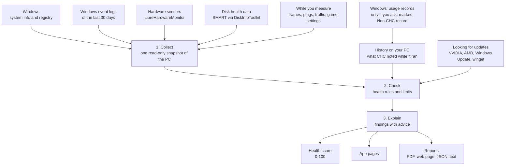

1. **Collect.** CHC reads what Windows and the hardware already know about themselves: the system information Windows keeps, the event logs, the sensors on the processor, graphics card and motherboard, and the health data every disk stores (SMART). When you measure a game or your connection, it also records frame times, pings and network traffic, and reads the game's settings file. Nothing on your PC is changed.
2. **Check.** Each value is compared with well-known limits, for example the temperature a processor or disk should stay under, or the SMART values that mean a disk is wearing out. Freezes and crashes are matched with the events logged in the 30 minutes before them. The rules live in readable files: [`HealthAnalyzer.cs`](src/CHC.Core/Health/HealthAnalyzer.cs) for the health checks, [`NetworkAnalyzer.cs`](src/CHC.Core/Network/NetworkAnalyzer.cs) and [`PerformanceAnalyzer.cs`](src/CHC.Core/Performance/PerformanceAnalyzer.cs) for the tests.
3. **Explain.** Every rule that matches becomes a *finding* with a title, an explanation and a recommendation, written for people who aren't computer experts.
4. **Score.** The findings add up to a score for each part and for the whole PC.
5. **Remember.** While CHC runs, it keeps a history on your PC, so it can compare today with last month and put problems next to what changed. You can turn this off. [What exactly it keeps](#what-chc-keeps-on-your-pc) is listed below.

### How the score works

Every finding has one of five levels:

| Level | Meaning | Effect on the score |
|---|---|---|
| 🟢 **OK** | Checked and healthy. | None |
| 🔵 **Tip** | Worth knowing, not a problem. | None |
| 🟣 **Update** | Something is out of date or waiting to be installed. | None |
| 🟠 **Warning** | Something needs your attention. | Lowers the score |
| 🔴 **Critical** | Act soon, for example back up a failing disk. | Lowers the score a lot |

A part with no warnings scores 100. Warnings take it down to between 85 and 45; only a critical problem takes it to 40 or below, so a few small issues never look worse than one serious one. The overall score works the same way across all parts: warnings alone keep it at 50 or above, and only a critical problem takes it lower. It is shown with a rating:

<table>
  <tr>
    <td align="center"><b>90–100</b><br>Excellent</td>
    <td align="center"><b>75–89</b><br>Good</td>
    <td align="center"><b>50–74</b><br>Fair</td>
    <td align="center"><b>0–49</b><br>Poor</td>
  </tr>
  <tr>
    <td align="center"><sub>No warnings</sub></td>
    <td align="center"><sub>A few things to look at</sub></td>
    <td align="center"><sub>Needs some attention</sub></td>
    <td align="center"><sub>A serious problem was found</sub></td>
  </tr>
</table>

One update does count: a Windows version that no longer gets security updates is listed with the updates and still counts as a warning. The game and network tests have their own scores and don't change the health score.

---

## A quick tour

### A short guide the first time you open it

CHC opens with a short tour of what is where, then offers a few settings, each with a note on what it does and why you might want it. You can skip the tour, the settings or both, and find the guide again in Settings.

<table>
  <tr>
    <td>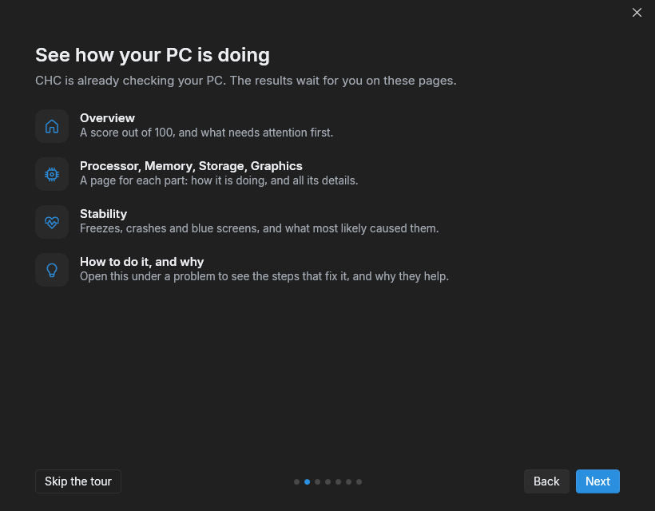</td>
    <td>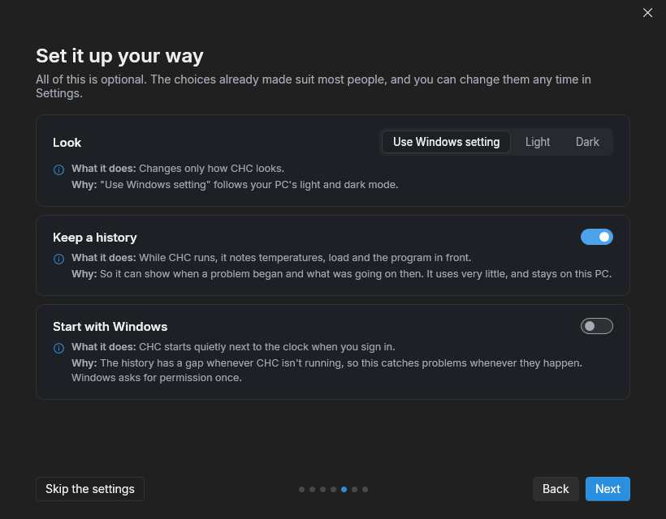</td>
  </tr>
  <tr>
    <td align="center"><sub>The tour</sub></td>
    <td align="center"><sub>Optional settings, each explained</sub></td>
  </tr>
</table>

### Problems first, in plain language

The overview lists every issue found on the PC, most serious first. Each one explains itself and comes with a suggestion.

<p align="center">
  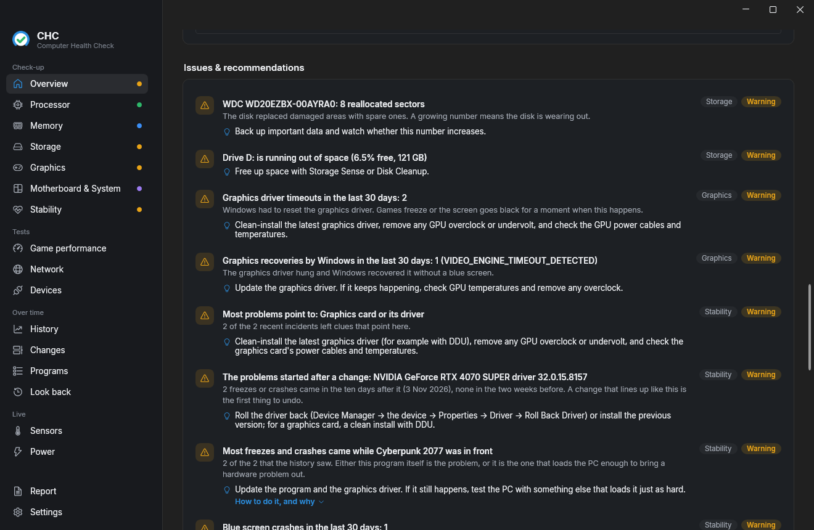
</p>

### What to update

Once a day CHC looks for what can be updated and lists it apart from the tips, with its own icon and a button to where you get it. CHC doesn't download or install anything itself.

- **Drivers and Windows come first:** a newer NVIDIA or AMD graphics driver, a newer AMD chipset driver, what Windows Update offers, a restart Windows is waiting for, an update that keeps failing, a Windows version that no longer gets security updates.
- **Programs come after that, as suggestions:** software other programs run on, such as .NET, and then your other programs. They don't count in the score.
- **What can't be looked up gets a link instead.** Intel graphics, your BIOS and the other motherboard drivers are on sites CHC can't read by itself, so it shows what you have and opens the maker's page.

<table>
  <tr>
    <td>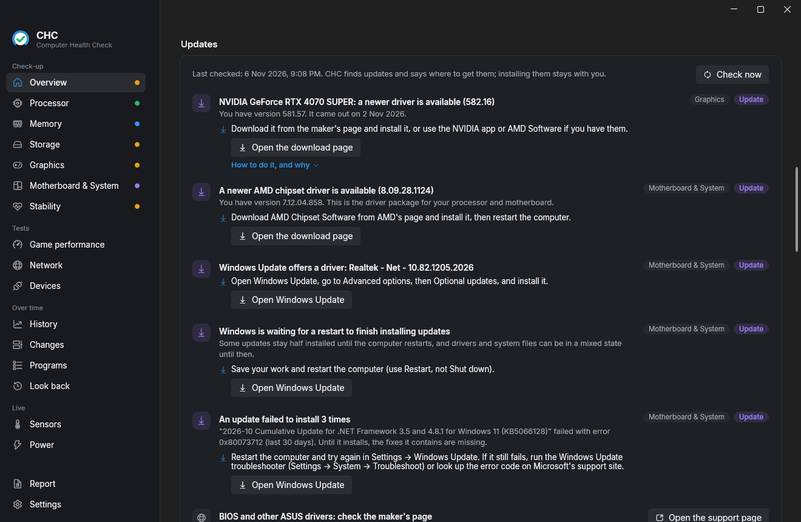</td>
    <td>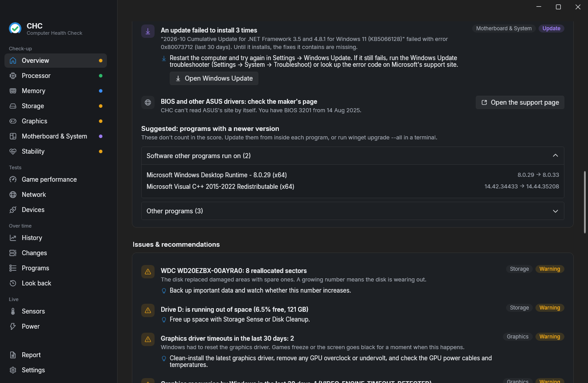</td>
  </tr>
  <tr>
    <td align="center"><sub>Drivers and Windows first</sub></td>
    <td align="center"><sub>The maker's page, and programs as suggestions</sub></td>
  </tr>
</table>

### Why did my PC freeze or crash?

CHC reads how each shutdown happened (a blue screen, a freeze that needed the power button, a sudden power loss, a failed wake-up, overheating) and what Windows logged in the minutes before it: graphics driver resets, hardware errors, disk timeouts, program crashes. From those clues it names the most likely cause of each incident and of most of them together, and suggests what to try first. If CHC's history covers that moment, it also says what was running and how hot and busy the PC was.

<p align="center">
  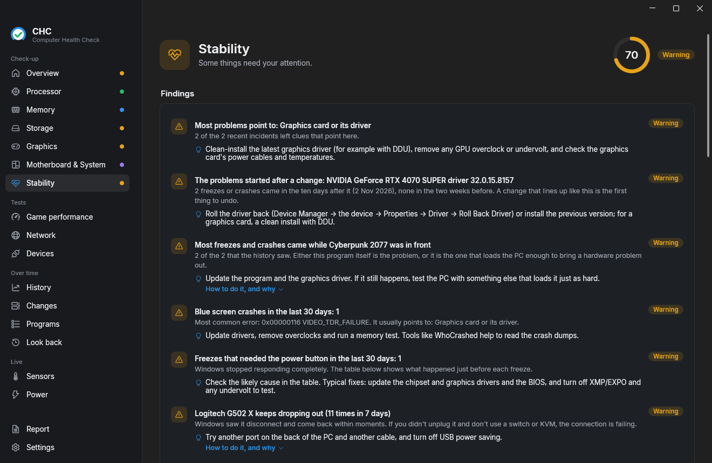
</p>

<p align="center">
  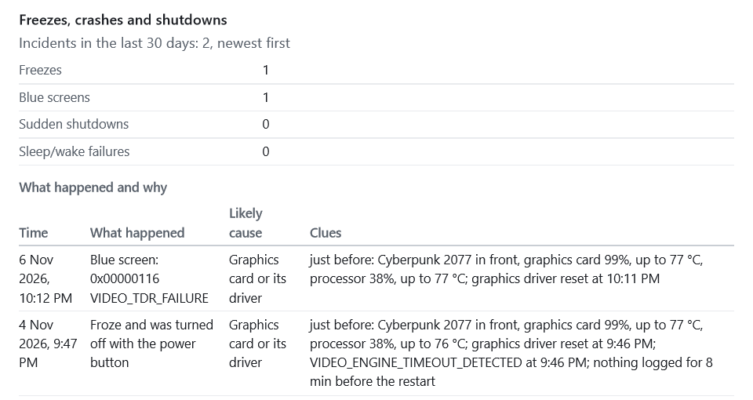
</p>
<p align="center"><sub>The same made-up graphics-driver problem, as the table appears in the report.</sub></p>

### What changed, and when

A PC rarely gets worse overnight. **Changes** is a timeline of drivers, Windows updates, programs, BIOS, hardware and settings, with the freezes and crashes in between, so you can see that the trouble started the day after a new driver. **History** shows temperatures, load, power and network traffic by day, week, month or year. **Power** compares the PC's highest draw with your power supply.

<table>
  <tr>
    <td>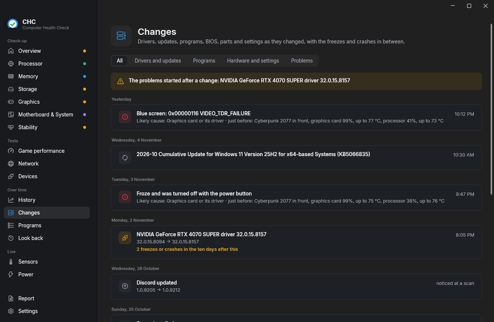</td>
    <td>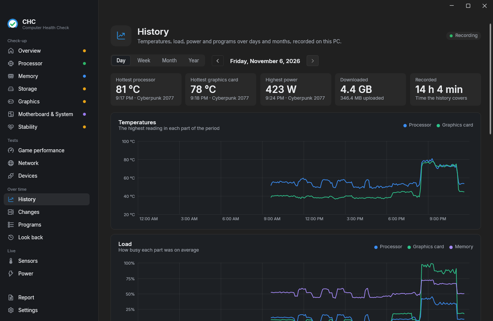</td>
  </tr>
  <tr>
    <td align="center"><sub>Changes</sub></td>
    <td align="center"><sub>History</sub></td>
  </tr>
</table>

<p align="center">
  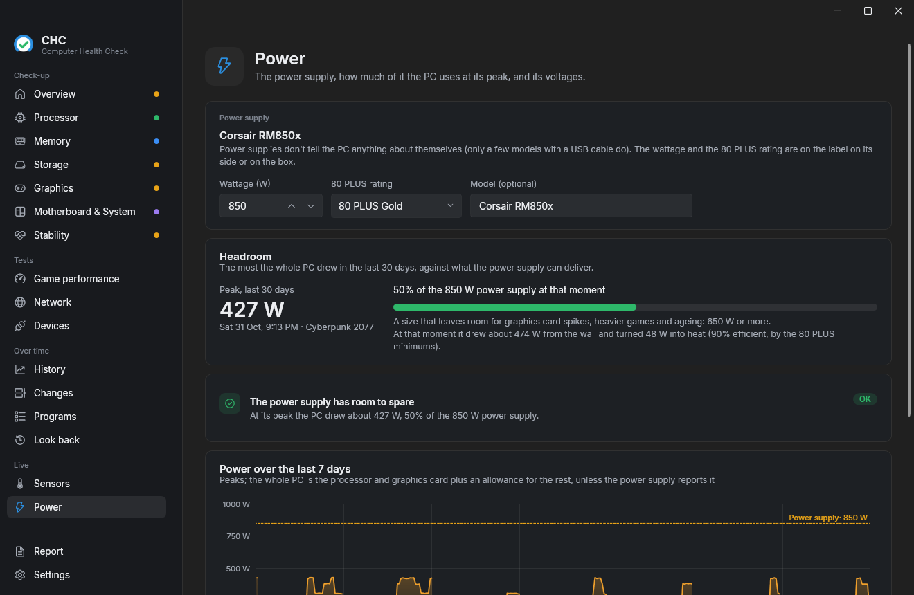
</p>

### See what holds your games back

Press **Start measuring**, play for a few minutes, then press **Stop**. CHC records the FPS and every stutter, and at the same time the processor, graphics card, memory and disk, so it can tell what actually limited your game: the graphics card, the processor or a single core, heat, a full graphics memory, a frame limit or background programs.

- **Online games are recognized automatically.** CHC then measures the ping to the game's server, jitter and packet loss while you play, and explains the difference between stutter (the PC) and lag (the connection).
- **Your game's own settings are read** for Unreal Engine games (such as Fortnite, VALORANT and PUBG), Unity games, Counter-Strike 2 and Minecraft. The advice then names the settings to lower first, or tells you what you can raise for free when the processor is the limit.
- **Power use:** how many watts the processor and graphics card drew, the whole PC's estimate and a suitable power supply size. On laptops: whether the game ran on battery or the charger couldn't keep up.

<p align="center">
  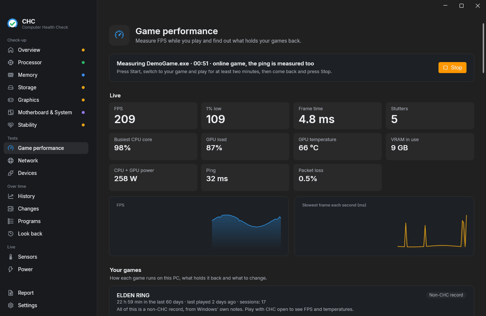
</p>

<table>
  <tr>
    <td>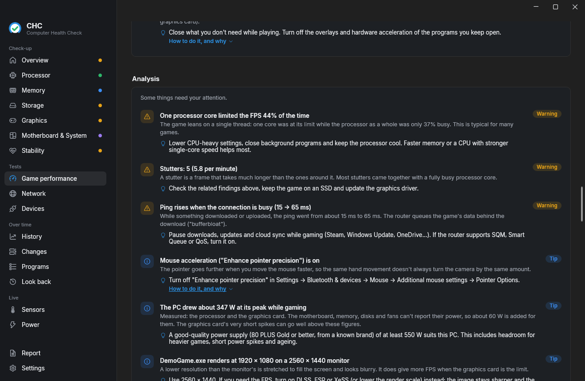</td>
    <td>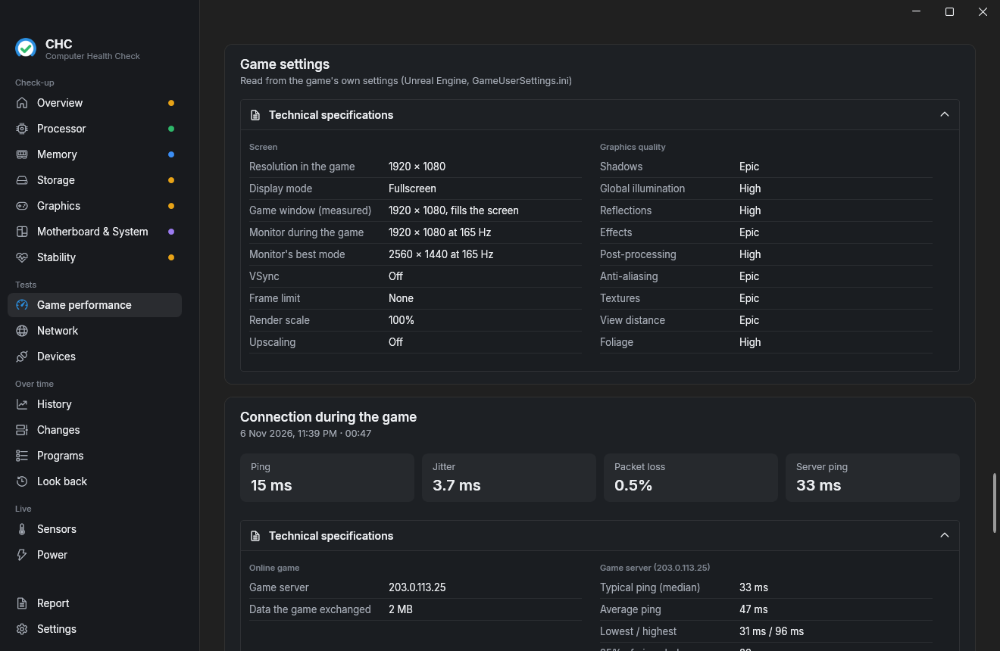</td>
  </tr>
  <tr>
    <td align="center"><sub>The analysis after the session</sub></td>
    <td align="center"><sub>The game's own settings, read from its settings file</sub></td>
  </tr>
</table>

**Your games** gathers all of this per game: how it runs on this PC over time, what holds it back, whether it got slower after a change, how often it crashes and what else ran beside it. You don't have to press anything for the everyday numbers: while CHC runs as administrator, it notes the frame rate as you play.

<p align="center">
  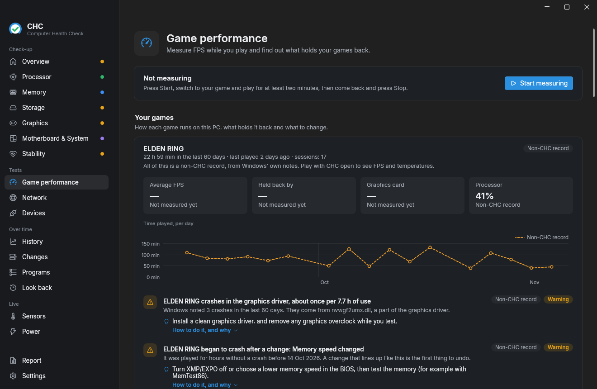
</p>

### Look back, even before CHC was installed

You don't have to wait for CHC to collect a history. Windows quietly notes which programs run on your PC, and if you ask, CHC reads those notes: when the PC was on, hour by hour, for about the last two months, which games and programs were open, and for about the last week what they used.

CHC didn't measure any of this itself, so it is always labelled **Non-CHC record**, on the charts too. The notes hold no FPS or temperatures: only CHC measures those, while it runs. [How the notes are read](#what-chc-keeps-on-your-pc) is explained below.

<p align="center">
  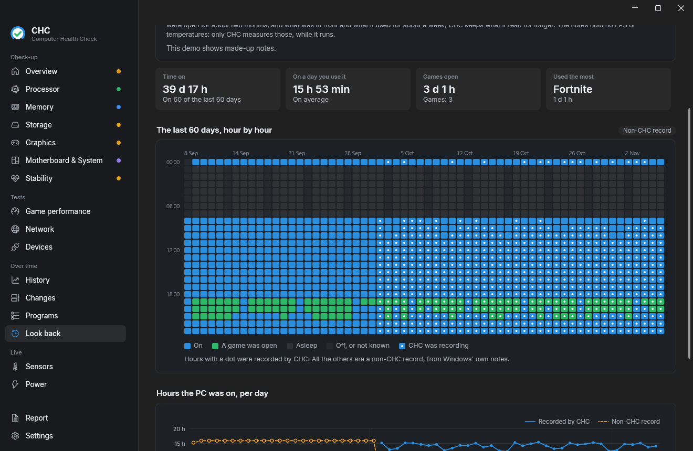
</p>

### Which program is doing that?

**Programs** shows what each program used over the last day, week, month or two months, in front or in the background, and points out the ones that stand out.

<p align="center">
  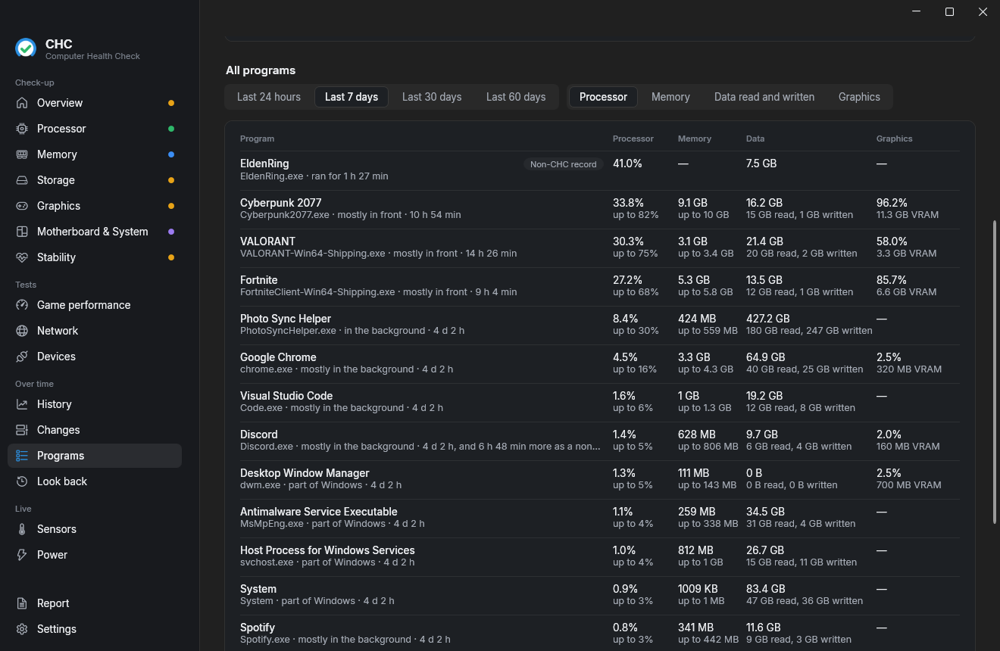
</p>

### What is plugged in

**Devices** lists what is connected by cable or wirelessly. It stays quiet unless something is really wrong: a missing or failing driver, a port that fails, a device that keeps dropping out, a USB drive stuck at USB 2 speed, a wireless device that is almost empty, a Wi-Fi connection that keeps getting lost. CHC notices devices arriving and going. It never reads what you type or click.

<p align="center">
  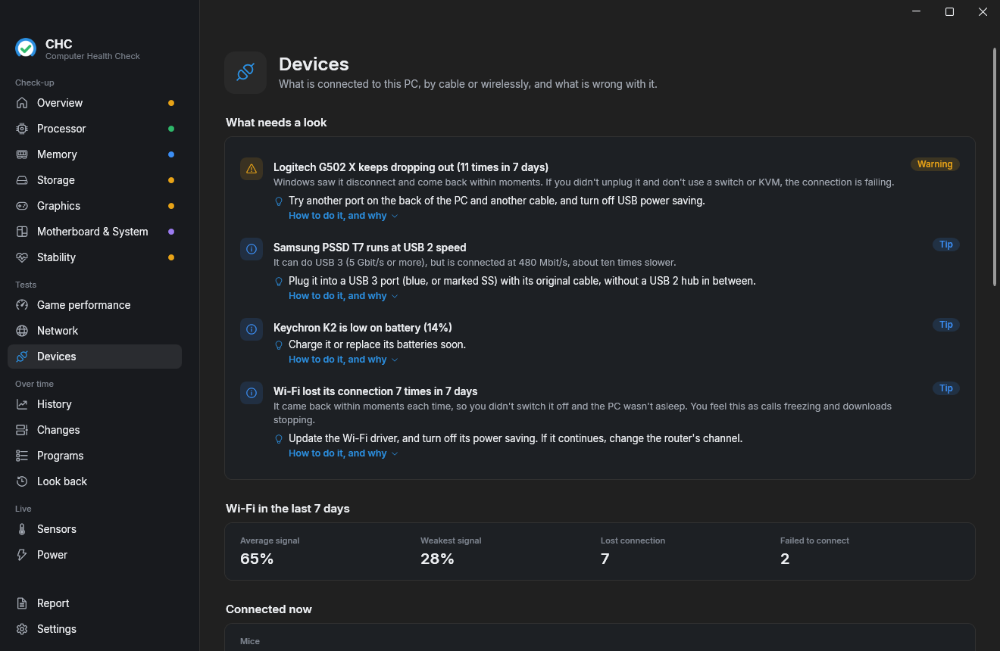
</p>

### Test your connection

Start the network test and use your PC as usual, or start a download to see what happens under load. CHC pings your router and two public servers several times a second, so it can tell whether lag comes from your Wi-Fi or cable, your router or your internet provider. It also catches *bufferbloat* (ping that jumps while something downloads) and shows which programs used the connection.

<table>
  <tr>
    <td>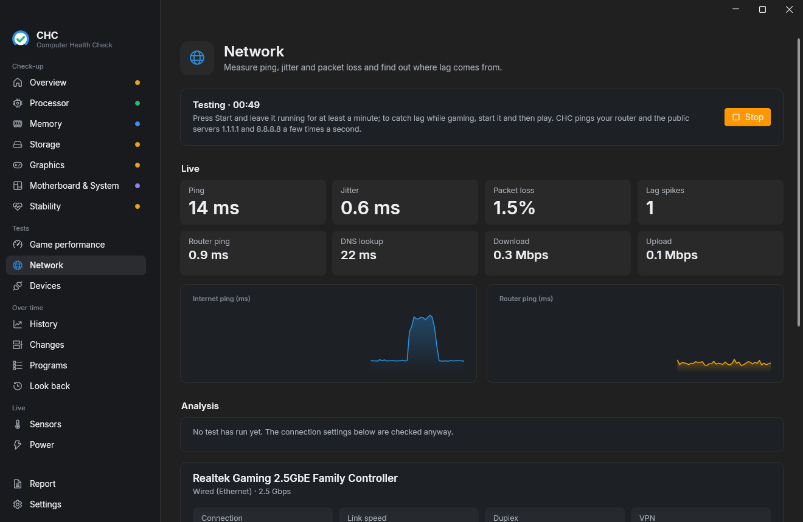</td>
    <td>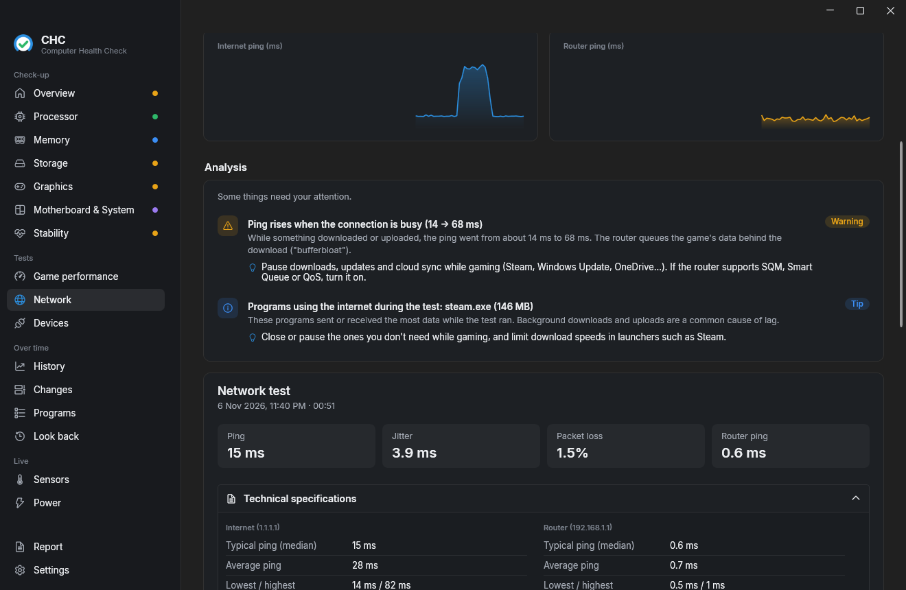</td>
  </tr>
  <tr>
    <td align="center"><sub>The test running live</sub></td>
    <td align="center"><sub>The result, explained</sub></td>
  </tr>
</table>

### From simple to technical

Every part has its own page. It starts with the findings and a few key numbers, then goes deeper: the full specifications, tables such as the SMART attributes or the memory modules, and finally every raw sensor reading. Read as far as you need. Light and dark themes follow your Windows setting.

<table>
  <tr>
    <td>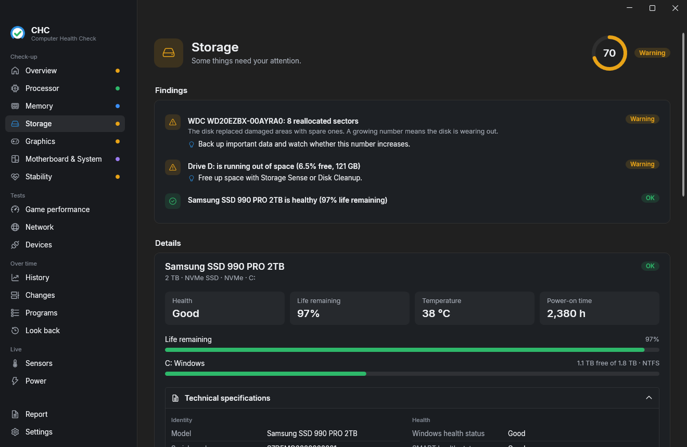</td>
    <td>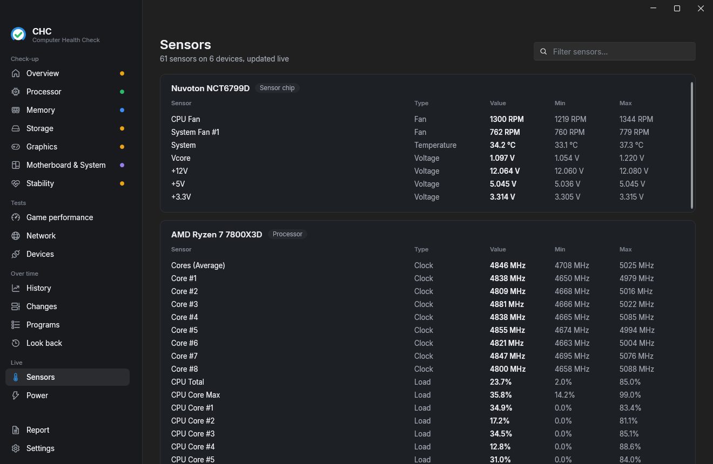</td>
  </tr>
  <tr>
    <td align="center"><sub>Storage: findings and key values first</sub></td>
    <td align="center"><sub>Every live sensor, with its lowest and highest value</sub></td>
  </tr>
</table>

### Laptops

On laptops CHC also looks at the battery: how much of its original capacity is left, how fast it wore over the last year (from the history Windows keeps), the power going in or out right now and the time left. It warns when the battery drains even though the laptop is plugged in, which means the charger is too weak.

<p align="center">
  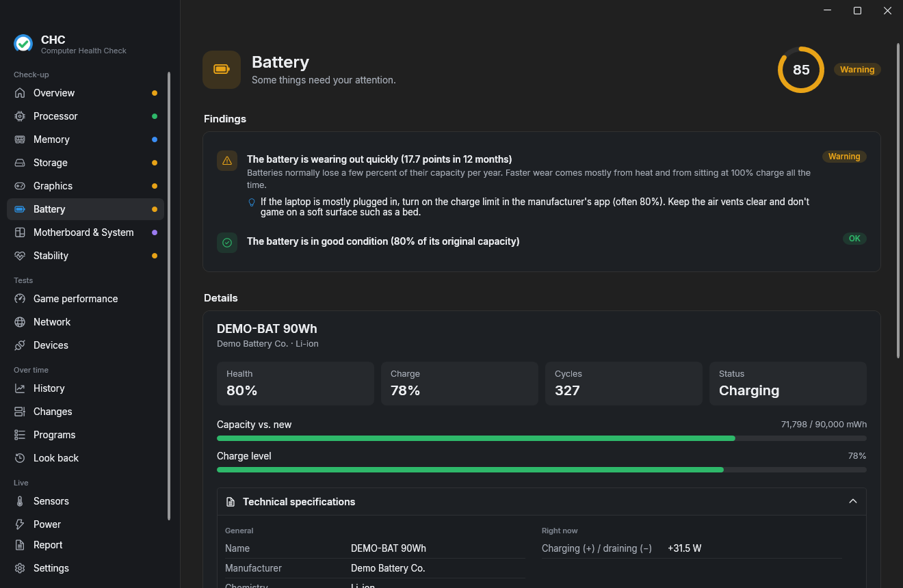
</p>
<p align="center"><sub>Demo mode's sample laptop.</sub></p>

### A report you can share

One click on **PDF report** saves a plain document, made to be read by someone who has never seen CHC: the score and what to do first, every problem with how to fix it, what to update, your games, what programs use, connected devices, when the PC was on, recent changes, and then the technical details of every part.

Serial numbers are hidden unless you choose to include them. The games, programs and on-times can be left out with one option, and the file name never contains your computer's name. You can also save the same report as a web page, export the raw data as JSON, or copy a short text summary for a forum post.

<p align="center">
  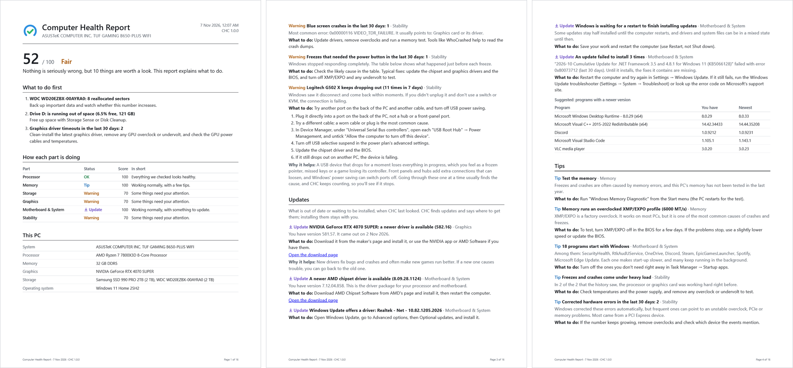
</p>

---

## Is it safe?

CHC is built to be trusted with a look inside your computer.

- **It doesn't change your PC.** CHC never changes settings, never overclocks, never "cleans" or "optimizes" anything, never downloads or installs updates and never touches your own files. It only writes its own files (see below) and the reports you choose to save. Game settings files are only read.
- **It goes online for very little, and you can see what.**
  - *Looking for updates, once a day:* CHC asks NVIDIA's or AMD's website for the newest driver of your graphics card or chipset, and lets Windows Update and winget do their own checks. Those sites see the model and what any visit shows, such as your IP address. You can turn this off in the first-run guide or in Settings; then it only looks when you press **Check now**.
  - *The network test, and a game you measure that turns out to be online:* they ping your router, `1.1.1.1` (Cloudflare), `8.8.8.8` (Google) and the game's server, and time a name lookup of `www.microsoft.com`.
  - Nothing else about you or your PC is sent anywhere: no telemetry, no analytics, no account, no ads.
- **It doesn't touch your games.** FPS and network traffic come from Windows' own event tracing (ETW), the method Microsoft's PresentMon uses. Nothing is injected into the game or changed in its files.
- **It never reads what you type or click.** There are no keyboard or mouse hooks in CHC. To tell when you are away, it only asks Windows how long ago the last input was.
- **Your data stays with you.** Apart from the model names above, nothing leaves your PC unless you save a report and share it yourself. Reports hide serial numbers by default and leave out your computer's name, your Windows user name and file paths.
- **The code is public.** Every check, every threshold and every text is in this repository. You can read exactly what CHC does, or build it yourself (see [For developers](#for-developers)).
- **It says how it was made.** CHC is built with an AI, and [this page says so](#how-chc-is-made).
- **It stands on well-known projects.** Hardware sensors come from [LibreHardwareMonitor](https://github.com/LibreHardwareMonitor/LibreHardwareMonitor), disk data from [DiskInfoToolkit](https://github.com/Blacktempel/DiskInfoToolkit) and event tracing from Microsoft's [TraceEvent](https://github.com/microsoft/perfview). The full list is in [THIRD-PARTY-NOTICES.md](THIRD-PARTY-NOTICES.md).
- **Administrator rights are optional.** CHC works without them and asks only when you want more data (see below). It never elevates itself silently: Windows asks you first. If you choose to start CHC with Windows, Windows asks once, and the sign-in task then starts CHC with those rights.
- **The installer downloads only what is missing, from the source.** The .NET runtime and WebView2 come from Microsoft. The optional PawnIO driver is pinned to one release and checked against its SHA-256 checksum before it runs, so a changed file is never installed. CHC uninstalls like any other app, from Windows Settings.

### What CHC keeps on your PC

All of this stays on your computer. CHC has no server to send it to.

**The history** is on by default and lives in `%LocalAppData%\CHC\history.db`. You can turn it off, or delete it, in Settings. While CHC runs it notes:

- temperatures, load, power and network traffic,
- the file name of the program in front, and for what runs fullscreen also the folder it is in,
- what each program used in total, per hour, of the processor, memory, disk and graphics card,
- the frame rate while you play,
- devices arriving and going, with their names and ids,
- how strong the Wi-Fi signal is, never the network's name,
- what changed on the PC: drivers, updates, installed programs, BIOS and hardware.

It never notes window titles, what you type, what is on screen or which sites you visit. Every minute is kept for 90 days (you can change this), and older days keep an hourly summary.

**Windows' usage records** (the Look back page) are read only after you ask:

1. You press **Read Windows' notes**. This needs administrator rights, so Windows asks for your permission unless CHC already runs as administrator.
2. CHC takes a moment's snapshot of the drive, because Windows keeps the file locked. It copies the records out, removes the snapshot and reads the copy.
3. It keeps program names and file paths, when they ran, how long they were in front, and their processor, disk and network numbers, for about four months. The copy is deleted. Everything from them is marked *Non-CHC record*.

There is an option to keep them up to date, off by default. With it on, CHC repeats this by itself about once a day, and only when it already runs as administrator.

**Other files:** your settings in `%AppData%\CHC`, what the last look for updates found and other working files in `%LocalAppData%\CHC`, and temporary files that CHC removes again. If you choose to start CHC with Windows, it also adds a scheduled task named `CHC\Background`.

### Why does Windows show a warning when I start it?

CHC is new and not code-signed yet (a signing certificate costs money every year). Windows SmartScreen therefore shows *"Windows protected your PC"* for any new, unsigned program. Click **More info → Run anyway**.

### How do I know my download is genuine?

Each release lists the SHA-256 checksums of its files. To compare, open PowerShell in your download folder and run:

```powershell
Get-FileHash .\CHC-Setup-1.0.0.exe -Algorithm SHA256
```

The value must match the one on the [Releases](../../releases) page exactly.

---

## Download and install

1. Download **`CHC-Setup-1.0.0.exe`** from the [latest release](../../releases/latest).
2. Run it. The setup installs CHC and downloads the .NET 10 Desktop Runtime and WebView2 only if they are missing.
3. Choose your options. It offers a desktop shortcut, always starting CHC as administrator, starting CHC next to the clock at sign-in so the history has no gaps, and the PawnIO driver. They are ticked by default, and you can untick any of them.

**Requirements:** Windows 10 or 11 (64-bit).

<p align="center">
  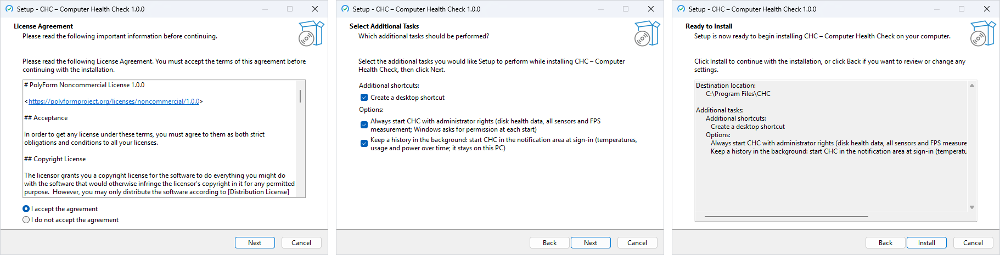
</p>
<p align="center"><sub>The PawnIO option only appears when the driver isn't installed yet.</sub></p>

### Normal mode, administrator mode and the PawnIO driver

CHC starts in **limited mode** without administrator rights. Click **Run as administrator** in the sidebar whenever you want the full picture, or tick the option in the installer.

| | Limited mode | Administrator | Administrator + PawnIO |
|---|:---:|:---:|:---:|
| Health score, findings, freeze and crash diagnosis, reports | ✅ | ✅ | ✅ |
| Memory, graphics card, Windows and stability checks | ✅ | ✅ | ✅ |
| Devices, History, Changes and Programs | ✅ | ✅ | ✅ |
| Network test: ping, jitter, packet loss, lag spikes | ✅ | ✅ | ✅ |
| Game measurement: what limits the game, temperatures, ping, game settings | ✅ | ✅ | ✅ |
| Looking for updates | ✅ | ✅ | ✅ |
| Look back: reading Windows' usage records | ✅ Windows asks first | ✅ | ✅ |
| FPS, stutters, game server ping, programs using the internet | | ✅ | ✅ |
| Disk health in detail (SMART) | | ✅ | ✅ |
| Processor temperature and power, fans, voltages, power supply suggestion | | | ✅ |

[PawnIO](https://pawnio.eu) is a free, signed driver that modern hardware monitoring tools, including LibreHardwareMonitor, use to read processor and motherboard sensors. The installer can set it up for you. CHC tells you when something can't be read and why.

---

## FAQ

<details>
<summary><b>Does CHC fix problems?</b></summary>

No. CHC finds and explains problems and tells you what to do, but it never changes anything on its own. You stay in control.
</details>

<details>
<summary><b>Is the health score a guarantee?</b></summary>

No. It is based on what your hardware reports and on common rules of thumb. It is a good indicator, not a promise. A disk can fail without warning signs, so always keep backups of important data.
</details>

<details>
<summary><b>Does CHC install updates?</b></summary>

No. It finds them and opens the page where you get them, or Windows Update. Installing stays with you.
</details>

<details>
<summary><b>Which updates can CHC find by itself?</b></summary>

Graphics drivers for NVIDIA GeForce cards and desktop AMD Radeon RX 5000 cards and newer, AMD's chipset drivers on desktop PCs, whatever Windows Update offers, and programs known to winget, Windows' own package manager. Intel graphics, your BIOS and the other motherboard drivers are on sites CHC can't read by itself: it shows what you have and opens the maker's page. If a driver isn't listed, it can still be newer on the maker's site.
</details>

<details>
<summary><b>What does "Non-CHC record" mean?</b></summary>

CHC didn't measure that part itself: it comes from the notes Windows keeps. It tells you what ran and for how long, but not the FPS or temperatures, which only CHC measures, while it runs.
</details>

<details>
<summary><b>Does CHC keep running in the background?</b></summary>

Only if you want it to. When you close the window, CHC can ask, keep recording next to the clock, or exit completely. **Start with Windows** starts it at sign-in. While CHC is closed the history has a gap, and nothing else happens. You can change all of this in Settings.
</details>

<details>
<summary><b>How do I delete what CHC recorded?</b></summary>

**Settings → Delete history** removes the whole history. Uninstalling CHC removes the program and its sign-in task, but leaves your settings and history behind, in `%AppData%\CHC` and `%LocalAppData%\CHC`. You can delete those two folders yourself. The PawnIO driver, if you installed it, stays too and has its own entry in Windows Settings.
</details>

<details>
<summary><b>Can measuring a game get me banned by anti-cheat?</b></summary>

CHC doesn't inject anything into the game, doesn't read its memory and doesn't change its files. It listens to the events Windows itself records about frames and network traffic, like Microsoft's PresentMon, and only reads the game's settings file.
</details>

<details>
<summary><b>Which games can CHC measure?</b></summary>

Any game you can play on Windows: FPS comes from Windows' own events for DirectX, Vulkan and OpenGL games, which needs administrator rights. The game's own settings are read for Unreal Engine games (such as Fortnite, VALORANT and PUBG), Unity games, Counter-Strike 2 and Minecraft (Java Edition). For other games the advice comes from the measurements alone.
</details>

<details>
<summary><b>Does the network test use much data?</b></summary>

No. It sends small pings (a few kilobytes per second) and doesn't download anything. Upload and download speeds are read from the traffic your PC is already making.
</details>

<details>
<summary><b>Why is my processor temperature missing?</b></summary>

Reading it needs administrator rights and the PawnIO driver. Run CHC as administrator and install PawnIO (the installer offers it), then scan again.
</details>

<details>
<summary><b>Why doesn't CHC have my language?</b></summary>

CHC is English only for now, while its features settle. Translations are planned once they have.
</details>

<details>
<summary><b>Is it really free?</b></summary>

Yes, for personal and other noncommercial use. Selling CHC or using it commercially is not allowed (see <a href="#license">License</a>).
</details>

<details>
<summary><b>Can I use it to check a second-hand PC before buying it?</b></summary>

Yes, that is a good use. Run CHC as administrator on the PC and look at disk health (SMART), the battery on laptops, temperatures under load and the freezes and crashes of the last 30 days. **Look back** also shows how much the PC was used over the last two months.
</details>

---

## For developers

<details>
<summary><b>Building from source</b></summary>

Requirements: Windows 10/11 x64 and the [.NET 10 SDK](https://dotnet.microsoft.com/download/dotnet/10.0).

```bash
git clone https://github.com/aliinal0/CHC.git
cd CHC
dotnet run --project src/CHC.App
```

Start it with the sample PC (no real data), the sample laptop, or the first-run guide:

```bash
dotnet run --project src/CHC.App -- --demo
dotnet run --project src/CHC.App -- --demo-laptop
dotnet run --project src/CHC.App -- --demo --welcome
```

Build the portable `CHC.exe` and the installer (needs [Inno Setup 6](https://jrsoftware.org/isinfo.php)):

```powershell
.\installer\build.ps1
```
</details>

<details>
<summary><b>Project structure</b></summary>

```
src/
  CHC.Core/                 Data collection, health rules, tests and reports (no UI)
    Collection/             WMI, registry, event log, SMART, network, device and battery collectors
    Sensors/                LibreHardwareMonitor wrapper (live sensors)
    Models/                 The snapshot: everything CHC read from the PC
    Health/                 HealthAnalyzer: every health rule and threshold in one place
    Diagnostics/            Freeze and crash incidents, stop codes and their likely causes
    Devices/                What is connected, what arrives and goes, and when to warn about it
    History/                The history database and what is recorded into it
    Timeline/               The changes timeline: drivers, updates, programs, BIOS, hardware
    Past/                   Reading Windows' usage records and making sense of them
    Updates/                Looking for newer drivers, Windows updates and programs
    Network/                The network test and its analysis
    Performance/            FPS capture (ETW), game settings readers and the game analysis
    Power/                  The power supply and what the PC draws
    Presentation/           Builds the display model shared by the app and the reports
    Reporting/              HTML/PDF template, JSON and text summary
    Localization/Languages  en.json, the text of the app
    Demo/                   The sample PC and laptop shown in demo mode
  CHC.App/                  WPF user interface (WPF UI, MVVM)
installer/                  Inno Setup script and build script
tools/                      Language file check and icon generator
```

Want to change a threshold or add a check? The health rules are in `src/CHC.Core/Health/HealthAnalyzer.cs`, and their texts are in `en.json` under the same keys.
</details>

Contributions are welcome: bug reports, hardware reports, new checks. See [CONTRIBUTING.md](CONTRIBUTING.md).

---

## How CHC is made

CHC is made by [aliinal0](https://github.com/aliinal0) with [Claude](https://claude.com/claude-code), Anthropic's AI, using Claude Code. aliinal0 decides what CHC should do and tries it on a real PC. Claude wrote most of the code and the texts, and is credited as co-author of the commits.

The code is all here to read, so you can judge it for yourself. CHC has been tested on only a few computers so far, so if it gets something wrong on yours, [please tell us](CONTRIBUTING.md#testing-chc-on-your-pc).

---

## License

CHC is released under the **[PolyForm Noncommercial License 1.0.0](LICENSE)**.

- ✅ You may use, study, modify and share CHC for free for personal and other noncommercial purposes.
- ❌ You may not sell CHC, distribute it for money or use it for commercial purposes.

Third-party components keep their own licenses; see [THIRD-PARTY-NOTICES.md](THIRD-PARTY-NOTICES.md).

## Disclaimer

The health score is based on the data your hardware reports and on common rules of thumb. It is a helpful indicator, not a guarantee. Always keep backups of important data.
