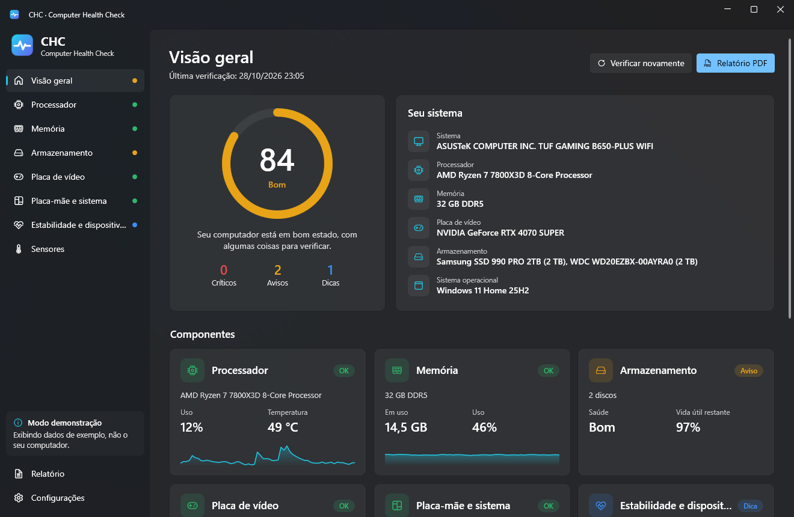

<p align="center">
  
</p>

<h1 align="center">CHC – Computer Health Check</h1>

<p align="center">
  Um aplicativo gratuito para Windows que verifica a saúde do seu PC (processador, memória, discos, placa de vídeo, bateria, placa-mãe e estabilidade do sistema) e explica os resultados, de um resumo em linguagem simples até os dados técnicos brutos.
</p>

<p align="center">
  <a href="README.md">English</a> ·
  <a href="README.tr.md">Türkçe</a> ·
  <a href="README.de.md">Deutsch</a> ·
  <a href="README.es.md">Español</a> ·
  <a href="README.fr.md">Français</a> ·
  <b>Português (Brasil)</b> ·
  <a href="README.ru.md">Русский</a> ·
  <a href="README.zh-CN.md">简体中文</a>
</p>

<p align="center">
  
</p>

## Recursos

- **Pontuação de saúde (0–100)** para o computador inteiro e para cada componente, com estados claros: *OK / Dica / Aviso / Crítico*.
- **Problemas e recomendações.** Cada resultado explica o que está errado, por que isso importa e o que fazer.
- **Do simples ao técnico.** Cada página de componente começa com um resumo curto e depois mostra valores ao vivo, especificações técnicas, tabelas (módulos de memória, atributos SMART, log de eventos) e todos os sensores brutos.
- **Processador:** uso, temperatura, frequências, potência, núcleos e threads, cache, virtualização.
- **Memória:** uso, memória confirmada, módulos por slot (tipo, velocidade, número da peça), detecção de canal único e de XMP/EXPO.
- **Armazenamento:** status de saúde do Windows e SMART completo (o mesmo mecanismo do CrystalDiskInfo, via DiskInfoToolkit): vida útil restante, temperatura, horas ligado, total gravado, setores realocados, pendentes e não corrigíveis, avisos críticos de NVMe e espaço livre por unidade.
- **Placa de vídeo:** temperatura, hot spot, temperatura da memória, uso, potência, VRAM, versão e idade do driver.
- **Bateria** (notebooks): nível de desgaste, capacidade de projeto e de carga completa, ciclos.
- **Placa-mãe e sistema:** versão e idade da BIOS/UEFI, Inicialização Segura, TPM, versão do Windows e tempo ativo.
- **Estabilidade:** desligamentos inesperados, telas azuis, erros de hardware WHEA e erros de disco dos últimos 30 dias, além de problemas no Gerenciador de Dispositivos.
- **Sensores ao vivo** para tudo o que o LibreHardwareMonitor consegue ler, com filtro.
- **Relatório PDF** com um clique e layout pronto. Também há exportação JSON e um resumo em texto para colar em fóruns. Os números de série ficam ocultos, a menos que você os ative.
- **8 idiomas:** English, Türkçe, Deutsch, Español, Français, Português (Brasil), Русский, 简体中文. Novos idiomas podem ser adicionados sem recompilar.
- Tema claro e escuro (segue o Windows), design Fluent do Windows 11.

## Download e execução

1. Baixe o `CHC.exe` na página de [Releases](../../releases).
2. Execute-o. O CHC precisa do [.NET 10 Desktop Runtime](https://dotnet.microsoft.com/download/dotnet/10.0) (se estiver faltando, o Windows oferece a instalação na primeira execução).

Sem permissão de administrador, o CHC abre em **modo limitado**. Clique em **Executar como administrador** na barra lateral para liberar os dados SMART e mais sensores.

A temperatura da CPU e os sensores da placa-mãe (ventoinhas, tensões) também precisam do driver gratuito e assinado [PawnIO](https://pawnio.eu), usado pelas ferramentas modernas de monitoramento. O CHC funciona sem ele e avisa quando está faltando.

> O CHC apenas lê informações. Ele nunca altera configurações, não faz overclock e não grava nada nos seus discos.

## Compilar a partir do código-fonte

Requisitos: Windows 10/11 x64 e o [SDK do .NET 10](https://dotnet.microsoft.com/download/dotnet/10.0).

```bash
git clone https://github.com/aliinal0/CHC.git
cd CHC
dotnet run --project src/CHC.App
```

Criar um único `CHC.exe`:

```bash
dotnet publish src/CHC.App -c Release -r win-x64 --self-contained false -p:PublishSingleFile=true -o publish
```

Quer mudar um limite ou adicionar uma verificação? Todas as regras estão em `src/CHC.Core/Health/HealthAnalyzer.cs`, e os textos, com as mesmas chaves, nos arquivos de idioma.

## Traduções

Todos os textos ficam em `src/CHC.Core/Localization/Languages/<código>.json`. Para adicionar um idioma:

1. Copie `en.json` como `<código>.json` (por exemplo, `it.json`).
2. Traduza os valores sem alterar as chaves nem os marcadores como `{0}`.
3. Abra um pull request ou coloque o arquivo na pasta `Languages` ao lado do `CHC.exe`. Ele aparece em **Configurações → Idioma** depois de reiniciar.

Veja mais detalhes em [CONTRIBUTING.md](CONTRIBUTING.md).

## Licença

O CHC é distribuído sob a **[PolyForm Noncommercial License 1.0.0](LICENSE)**.

- ✅ Você pode usar, estudar, modificar e compartilhar o CHC gratuitamente para fins pessoais e outros fins não comerciais.
- ❌ Você não pode vender o CHC, distribuí-lo por dinheiro nem usá-lo para fins comerciais.

Os componentes de terceiros mantêm suas próprias licenças: [THIRD-PARTY-NOTICES.md](THIRD-PARTY-NOTICES.md).

## Aviso

A pontuação de saúde se baseia nos dados informados pelo seu hardware e em regras práticas comuns. É um indicador útil, não uma garantia. Sempre faça backup dos seus dados importantes.
