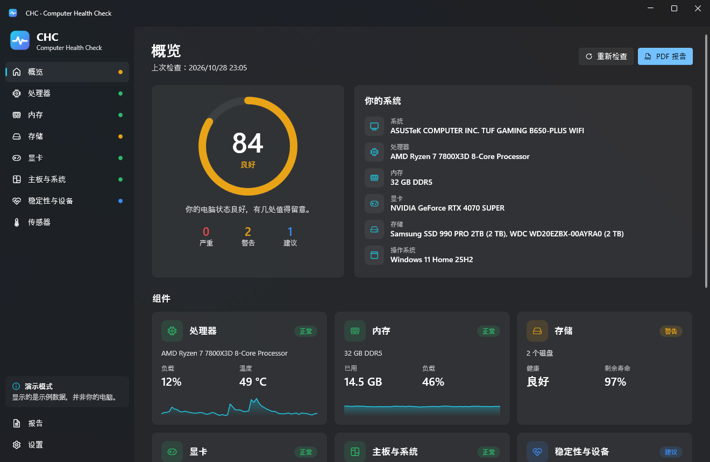

<p align="center">
  
</p>

<h1 align="center">CHC – Computer Health Check</h1>

<p align="center">
  一款免费的 Windows 应用，用于检查电脑的健康状况（处理器、内存、磁盘、显卡、电池、主板和系统稳定性），并从通俗易懂的摘要到原始技术数据，逐层解释检查结果。
</p>

<p align="center">
  <a href="README.md">English</a> ·
  <a href="README.tr.md">Türkçe</a> ·
  <a href="README.de.md">Deutsch</a> ·
  <a href="README.es.md">Español</a> ·
  <a href="README.fr.md">Français</a> ·
  <a href="README.pt-BR.md">Português (Brasil)</a> ·
  <a href="README.ru.md">Русский</a> ·
  <b>简体中文</b>
</p>

<p align="center">
  
</p>

## 功能

- 为整台电脑和每个组件给出 **0–100 的健康评分**，状态清晰：*正常 / 建议 / 警告 / 严重*。
- **问题与建议。** 每条结果都会说明哪里有问题、为什么重要以及该怎么做。
- **由浅入深。** 每个组件页面先给出简短摘要，然后是实时数值、技术规格、表格（内存条、SMART 属性、事件日志）以及所有原始传感器。
- **处理器：** 负载、温度、频率、功耗、核心与线程、缓存、虚拟化。
- **内存：** 占用、已提交内存、各插槽的内存条（类型、速度、型号），并检测单通道和 XMP/EXPO。
- **存储：** Windows 健康状态和完整的 SMART 数据（与 CrystalDiskInfo 相同的引擎，通过 DiskInfoToolkit 实现）：剩余寿命、温度、通电时间、总写入量、重映射/待映射/无法纠正的扇区、NVMe 严重警告以及各分区可用空间。
- **显卡：** 温度、热点温度、显存温度、负载、功耗、显存容量、驱动版本和发布时间。
- **电池**（笔记本）：损耗程度、设计容量与完全充电容量、循环次数。
- **主板与系统：** BIOS/UEFI 版本和发布时间、安全启动、TPM、Windows 版本和运行时间。
- **稳定性：** 最近 30 天的意外关机、蓝屏、WHEA 硬件错误和磁盘错误，以及设备管理器中的问题。
- **实时传感器：** 显示 LibreHardwareMonitor 能读取的所有数据，并支持筛选。
- **一键生成 PDF 报告**，自带排版好的模板。另外支持导出 JSON 和复制文本摘要（方便发到论坛）。除非你主动开启，否则序列号会被隐藏。
- **8 种语言：** English、Türkçe、Deutsch、Español、Français、Português (Brasil)、Русский、简体中文。无需重新编译即可添加更多语言。
- 浅色和深色主题（跟随 Windows），采用 Windows 11 Fluent 设计。

## 下载与运行

1. 从 [Releases](../../releases) 页面下载 `CHC.exe`。
2. 运行即可。CHC 需要 [.NET 10 Desktop Runtime](https://dotnet.microsoft.com/download/dotnet/10.0)（如果缺少，Windows 会在首次启动时提示安装）。

没有管理员权限时，CHC 以 **受限模式** 启动。点击侧边栏中的 **以管理员身份运行** 即可读取 SMART 数据和更多传感器。

CPU 温度和主板传感器（风扇、电压）还需要免费且已签名的 [PawnIO](https://pawnio.eu) 驱动，现代硬件监控工具都在使用它。没有它 CHC 也能运行，并会在缺少时提示你。

> CHC 只读取信息。它不会更改任何设置，不会超频，也不会向你的磁盘写入数据。

## 从源代码构建

要求：Windows 10/11 x64 和 [.NET 10 SDK](https://dotnet.microsoft.com/download/dotnet/10.0)。

```bash
git clone https://github.com/aliinal0/CHC.git
cd CHC
dotnet run --project src/CHC.App
```

生成单个 `CHC.exe`：

```bash
dotnet publish src/CHC.App -c Release -r win-x64 --self-contained false -p:PublishSingleFile=true -o publish
```

想修改阈值或添加新的检查项？所有规则都在 `src/CHC.Core/Health/HealthAnalyzer.cs` 中，对应文本以相同的键保存在语言文件里。

## 翻译

所有文本都在 `src/CHC.Core/Localization/Languages/<代码>.json` 中。添加新语言的步骤：

1. 将 `en.json` 复制为 `<代码>.json`（例如 `it.json`）。
2. 翻译所有值，保持键和 `{0}` 等占位符不变。
3. 提交 pull request，或把文件放到 `CHC.exe` 旁边的 `Languages` 文件夹中。重启后即可在 **设置 → 语言** 中看到。

详情请参阅 [CONTRIBUTING.md](CONTRIBUTING.md)。

## 许可证

CHC 采用 **[PolyForm Noncommercial License 1.0.0](LICENSE)** 发布。

- ✅ 你可以出于个人及其他非商业目的免费使用、研究、修改和分享 CHC。
- ❌ 你不得出售 CHC、收费分发或将其用于商业目的。

第三方组件保留各自的许可证：[THIRD-PARTY-NOTICES.md](THIRD-PARTY-NOTICES.md)。

## 免责声明

健康评分基于硬件报告的数据和常见的经验规则，是有用的参考，而不是保证。请务必备份重要数据。
